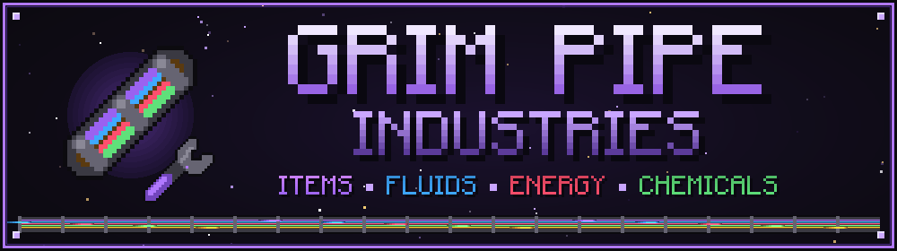
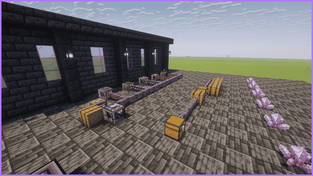
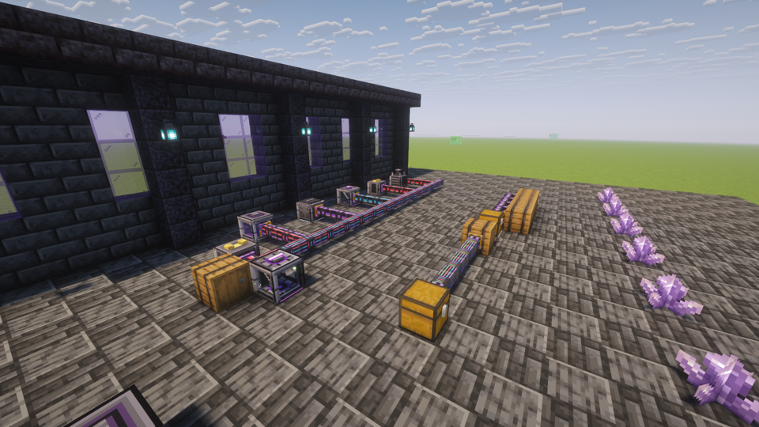
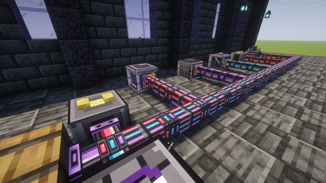
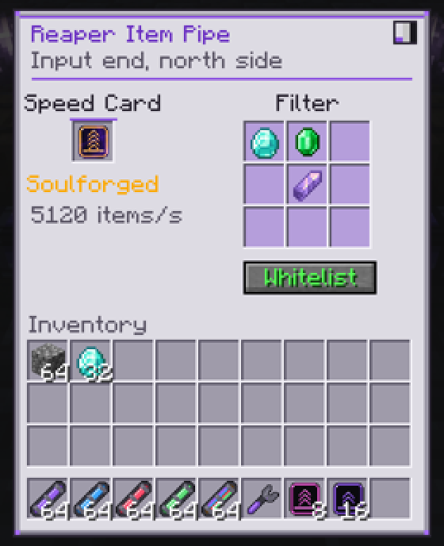
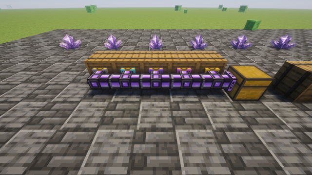
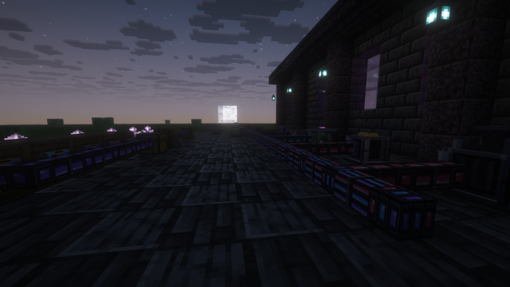
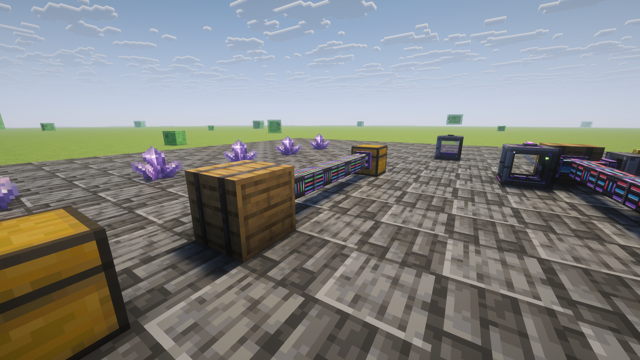

<p align="center"></p>

<p align="center">
  
  
  
  
</p>

<p align="center">
  <a href="https://www.curseforge.com/minecraft/mc-mods/grim-pipe-industries"></a>
  <a href="https://github.com/PCPx00/grim-pipe-industries"></a>
  <a href="https://github.com/PCPx00/grim-pipe-industries/issues"></a>
</p>

<p align="center">
  <b>Items. Fluids. Energy. Chemicals. One clean pipe.</b><br>
  Minimal, lag-free pipes for <b>NeoForge 1.21.1</b>, built to match <a href="https://github.com/PCPx00/grim-soul-industries">Grim Soul Industries</a>.
</p>

<p align="center"></p>

## Overview

Grim Pipe Industries is a small, black-and-purple pipe mod that stays out of your way. Place a pipe, flip the end you want to pull from to **Input** with the **Reaper Wrench**, and you're done. Every pipe is the same clean size. You can stack several kinds into **one block**, so an item pipe, a fluid pipe and an energy pipe can all connect to **the same side** of one machine. Speed comes from cards you put **only in the Input end**, never in the pipes in between.

<p align="center"></p>

<p align="center"></p>

| Pipe | Moves |
| --- | --- |
| **Reaper Item Pipe** | Items, from any inventory (chests, machines, AE2, Refined Storage, Sophisticated Storage...) |
| **Reaper Fluid Pipe** | Any fluid, from any tank |
| **Reaper Energy Pipe** | Forge Energy (FE), from any generator or battery |
| **Reaper Chemical Pipe** | Mekanism gases, infuse types, pigments and slurries (Mekanism optional) |
| **Reaper Omni Pipe** | **All four** on a single pipe |

Pipes store nothing, so nothing can get stuck, mixed or lost inside them. Items arrive instantly with no item entities to render. Outputs are served round-robin, so every machine on a line gets its share.

<p align="center"></p>

Right-click a placed pipe with a different pipe and both share that block, each as its own strand. A **bundle** can hold any mix of the five, and every strand connects to the **same face** of a chest or machine on its own. Pull drops out of a Virtualization Chamber and push power into it, both through the one face.

- Every pipe uses the **same casing size**. Strands that share a block show as neat **colored bands** inside it, always in the same order. A bundle lines up perfectly with a single pipe next to it.
- Each arm only shows the strands that actually go that way. Branch off the fluid strand and the rest of the bundle keeps going.
- Sneak-click the face of a chest that already has a pipe in front of it, holding a second pipe, to add it there directly.

<p align="center"></p>

<p align="center"></p>

| Reaper Wrench | Does |
| --- | --- |
| Click a pipe end | Switch it between **Output** (purple plate) and **Input** (gold plate, pulls from the block) |
| Sneak-click an end, or click a link between pipes | Disconnect that side |
| Click a pipe's core on a side with no arm | Reconnect it |
| Sneak-click a core | Take that one strand out of the block |

The wrench targets the exact band you click, so in a bundle you flip just the strand you mean. Any wrench tagged `c:tools/wrench` from another mod works too.

**Empty-hand right-click an Input end** to open its screen:

- **Speed card slot:** drop a card in or take it out. The screen shows the exact speed that end runs at.
- **9-slot filter:** click with an item to add it (your item is not used up), or shift-click from your inventory. Buckets filter fluids.
- **Whitelist** (only pull these), **Blacklist** (pull everything except these) or **Void** (pull everything and delete what's in the filter).
- **Three styles**, switched from the corner button: *Reaper*, *Vanilla* and *Dark*, the same as Grim Soul Industries.

Machines that push on their own (hoppers, generators, auto-eject) can push straight into an Input end, and its filter still applies.

<p align="center"></p>

<p align="center"></p>

Speed cards use the Grim Soul Industries tiers and colors. Only **Input ends** need one: a single Soulforged card on the end that pulls runs a whole line of plain pipes at full speed. The card's color shows on the corners of the end plate.

| Tier | Items | Fluid | Energy | Chemicals |
| --- | --- | --- | --- | --- |
| **Hollow** (no card) | 8 /s | 100 mB/t | 1,000 FE/t | 200 mB/t |
| **Whispering** | 32 /s | 400 mB/t | 8,000 FE/t | 800 mB/t |
| **Restless** | 128 /s | 1,600 mB/t | 64,000 FE/t | 3,200 mB/t |
| **Wraithbound** | 640 /s | 6,400 mB/t | 512,000 FE/t | 12,800 mB/t |
| **Soulforged** | 5,120 /s | 25,600 mB/t | 4,096,000 FE/t | 51,200 mB/t |

All of these can be changed in `config/grimpipes-common.toml`.

<p align="center"></p>

<p align="center"></p>

- **Pipe blocks never tick.** One manager per world runs whole networks, and the work grows with the number of pipe *ends*, not pipe blocks.
- **Networks are built once and cached.** A change only rebuilds the networks it touches, batched to the next tick.
- **Idle ends back off** automatically and wake up the moment you change their card or filter.
- **Pipes are baked into the chunk mesh** like normal blocks, so there's zero per-frame rendering cost. No entities, no flying items.
- **Never loads chunks.**
- Measured on a real server: a single network of **1,024 pipes with 32 ends** costs about **0.03 ms per tick**, roughly 0.06% of the tick budget.

<p align="center"></p>

## Gallery
| | |
| --- | --- |
|  |  |
|  |  |

<p align="center"></p>

## Requirements
- Minecraft **1.21.1**
- NeoForge **21.1.0** or newer
- Optional: **Mekanism** 10.7+ for the Chemical Pipe (and the chemical part of the Omni Pipe)

Needed on both client and server.

## Compatibility
Works with anything that uses the standard NeoForge item, fluid and energy capabilities: Mekanism, Applied Energistics 2, Refined Storage, Thermal, Create, Industrial Foregoing, Powah, Grim Soul Industries, plain hoppers and chests, and much more.

## Building from source
```
./gradlew build
```
The jar appears in `build/libs/`. On Windows you can double-click `BUILD.bat` (see `BUILD_GUIDE.md`).

## Modpacks
Yes! You may include Grim Pipe Industries in any modpack on CurseForge or Modrinth. It was made for, and first shipped in, the **Nine Craft** modpack, alongside Grim Soul Industries.

## License
Copyright © 2026 xTri6. All Rights Reserved. See [LICENSE](LICENSE) for what you can and can't do.
